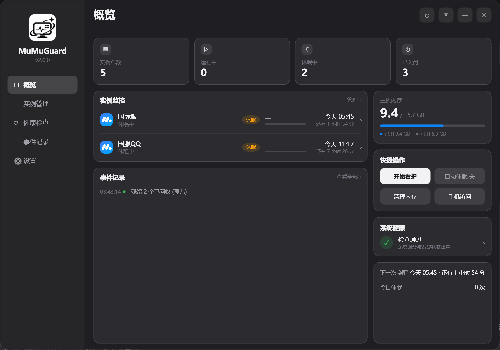
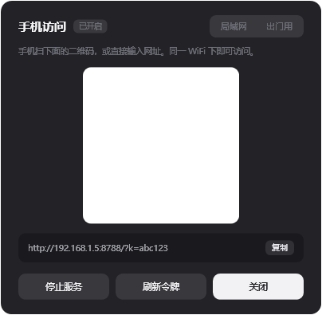
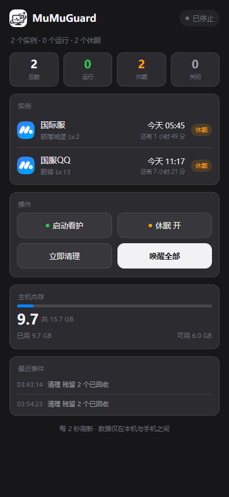



# MuMuGuard：MuMu 模拟器多开看护面板

盯着每个实例，掉线自动拉起，等升级时休眠省内存，醒来自动接着跑。


<br clear="left">

---

## 它是什么

MuMuGuard 是给 MuMu 模拟器多开用的看护面板，运行在 Windows 10 / 11 上。它把每个实例的状态收在一个窗口里：内存、CPU、脚本和游戏是否在跑、升级还剩多久。脚本掉了会自动重启，等建筑升级时可以关掉模拟器省内存，快到时间再打开。

它不改 MuMu 本体，不改你的多开配置，不装系统服务，也不上传数据。看护要手动点开始，程序不会自己启动。

项目地址：[github.com/suuk324/MuMuGuard](https://github.com/suuk324/MuMuGuard)

---

## 界面长什么样

2.0.0 把界面重做成左侧导航加右侧内容区，一共五个页面。主题有跟随系统、深色、浅色三种，在设置页点一下即时切换，不用重启。



### 五个页面

| 页面 | 放什么 |
|---|---|
| **概览** | 实例总数、运行中、休眠中、已关闭四张统计卡；实例监控；最近事件；主机内存；快捷操作；系统健康；下一次唤醒和今日休眠 |
| **实例管理** | 每个实例一行，带检测开关、详情，以及启动 / 唤醒 / 重启 |
| **健康检查** | 内存压缩、系统预取、Mem Reduct、页面文件、CEF、权限六项体检 |
| **事件记录** | 今日休眠、自动唤醒、内存清理、异常恢复四个数字，下面是完整事件 |
| **设置** | 24 项可调项，分休眠、掉线恢复、资源告警与清理、路径与包名、其它五组 |

概览里的实例行可以直接点进实例管理，右上角「管理 ›」、事件区的「查看全部 ›」、右侧「系统健康」卡也都能点，不用先找侧栏。

事件记录页有搜索框，按实例名或事件内容过滤；下面还有「全部 / 告警 / 休眠」三个筛选，可以叠加使用。

### 实例详情

实例管理每行都有一个「详情」。点开能看到序号、游戏和等级、升级剩余时间、预计完成时刻、休眠倒计时、内存占用、CPU 情况，以及掉线检测是开启还是已暂停。底部可以直接暂停或恢复这个实例的检测，不影响其它实例。

### 主题和设置


切到浅色后是同一套布局，颜色、文字和图标一起换，不会留下深色底。


设置页的每一行都是「名称 + 一句说明 + 右侧开关或数值」。开关点一下切换，数值点右侧的胶囊直接输入，路径和包名也是点进去改。改完立刻保存，同时写进 `config.json`，不需要重启。

---

## 能做什么

| 功能 | 说明 |
|---|---|
| **多开监控** | 自动发现 MuMu 实例，显示内存、CPU、CEF 进程数、脚本与游戏状态 |
| **掉线自恢复** | 连续检测到脚本或游戏掉线后重启实例，并重新拉起脚本 |
| **空转识别** | 脚本在跑但 CPU 长期很低时标出来，避免白挂一晚上 |
| **CEF 泄漏清理** | 清掉堆积的浏览器组件进程（`CefViewWing.exe`），每个实例保留指定数量 |
| **升级休眠** | 等升级时关掉模拟器省内存，升级完成前自动唤醒 |
| **健康自检** | 内存压缩、系统预取、Mem Reduct、页面文件、CEF、权限六项 |
| **实例详情** | 内存、CPU、升级进度、休眠倒计时、检测状态集中在一处 |
| **事件搜索** | 按实例名或事件内容找记录，也能只看告警或只看休眠 |
| **手机看状态** | 局域网扫码，或走公网中转；能看状态，也能按四个常用动作 |
| **托盘与紧凑视图** | 收起后只留托盘图标，紧凑视图 344×182 挂在角落 |

**它不做什么**：不上传你的数据、不安装常驻服务、不改 MuMu 本体、不动你的多开配置。

---

## 怎么安装

### 方式一：下载 exe

1. 到 [Releases](../../releases) 下载最新的 `MuMuGuard.exe`
2. 放到一个固定的文件夹，**不要放 `C:\Program Files`**，那里写配置会有权限问题
3. 双击运行。如果 SmartScreen 提示未知发布者，点「更多信息」再点「仍要运行」

首次启动会在程序所在目录创建 `config.json`，并自动查找 MuMu 安装位置。

### 方式二：源码运行

```powershell
git clone https://github.com/suuk324/MuMuGuard.git
cd MuMuGuard
powershell -STA -NoProfile -ExecutionPolicy Bypass -File .\MuMuGuardApp.ps1
```

需要 PowerShell 5.1，Windows 10 / 11 自带，不用另外装东西。

### 脚本版和 exe 版的数据

两个版本现在共用同一套数据。程序按这个顺序找配置：`_dist\config.json` → 程序所在目录的 `config.json` → `%LOCALAPPDATA%\MuMuGuard\config.json`。所以只要把 exe 放进 `_dist`，源码版和 `_dist\MuMuGuard.exe` 读写的就是同一份设置、休眠任务和日志。

如果把 exe 复制到了别的文件夹，它会用自己旁边的数据，看起来就像设置丢了。想保持一致，把 exe 放回 `_dist`，或者把旧的 `config.json` 复制过去。

---

## 第一次使用

1. 先启动 MuMu 和你的脚本
2. 打开 MuMuGuard，点侧栏 **实例管理**，确认实例都被认出来
3. 回 **概览**，点「开始看护」；需要省内存的话再点一下「自动休眠 关」变成开启
4. 平时用紧凑视图挂着，要看细节点回来

看护是手动开启的。程序不会自动开始看护，开机自启默认也是关的。

---

## 设置项说明

设置页一共 24 项，按五组排列。下面按页面顺序列出，默认值取自程序内置配置。

### 休眠

| 设置项 | 默认 | 说明 |
|---|---|---|
| 自动休眠 | 关 | 脚本在等升级时关掉模拟器省内存，升级前自动唤醒 |
| 后台也休眠 | 开 | 游戏退到后台时也允许休眠 |
| 后台空闲判定 | 10 分钟 | 游戏退到后台多少分钟后，才按「在等升级」处理 |
| 提前唤醒 | 10 分钟 | 升级完成前多少分钟启动模拟器 |
| 最短休眠 | 1 小时 | 剩余时间比这短就不睡，避免反复开关机 |
| 最长休眠 | 168 小时 | 剩余时间比这长就不睡，比如两天以上 |

### 掉线恢复

| 设置项 | 默认 | 说明 |
|---|---|---|
| 掉线自动恢复 | 开 | 脚本或游戏掉线时重启实例，并重新拉起脚本 |
| 检测间隔 | 60 秒 | 每隔多久检查一次实例是否掉线 |
| 连续几次判定掉线 | 2 次 | 连续失败这么多次才重启，减少误判 |
| 恢复冷却 | 10 分钟 | 两次自动恢复之间至少隔这么久，防止反复重启 |

### 资源告警与清理

| 设置项 | 默认 | 说明 |
|---|---|---|
| 清理间隔 | 5 分钟 | 看护每隔多久做一次内存清理，0 表示不清理 |
| 低内存告警 | 800 MB | 主机可用内存低于这个值时报警 |
| 单实例内存告警 | 9216 MB | 单个实例占用超过这个值时报警 |
| CPU 告警 | 4 核 | 单个实例 CPU 占用超过这个值时标记出来 |
| CEF 泄漏阈值 | 20 个 | 单个实例的 CEF 进程超过这个数就判定为泄漏 |
| CEF 保留数量 | 3 个 | 清理时每个实例保留几个 CEF 进程 |
| 仅清理闲置进程 | 10 分钟 | 只清理闲置超过这么久的 CEF，避免误伤刚启动的 |
| 空转阈值 | 50% | CPU 低于这个百分比视为空转，可以被清理 |

### 路径与包名

| 设置项 | 默认 | 说明 |
|---|---|---|
| MuMu 安装路径 | 自动识别 | `MuMuManager.exe` 所在目录，换版本或换盘后改这里 |
| 脚本包名 | `com.coc.zkqcode` | 用来判断脚本是否在运行，换成你自己脚本的包名 |
| 游戏包名 | 内置 CoC 包名 | 用来判断游戏是否在前台，多个包名用空格隔开 |

### 其它

| 设置项 | 默认 | 说明 |
|---|---|---|
| 开机自动启动 | 关 | 开机后自动进托盘常驻，会写入注册表启动项 |
| 日志保留 | 7 天 | 超过这个天数的日志自动删除 |
| 主题 | 跟随系统 | 在跟随系统、深色、浅色之间切换，点一下即时生效 |

设置页底部还有几项工具：

- **清除记忆**：删掉全部休眠任务、内存趋势、今日统计、事件记录和已导出的报告，设置项保留。当天数字会立即归零。正在休眠的实例不会再自动唤醒，清之前想清楚。
- **导出设置**：把当前设置导出成一个文件，换电脑或重装前留个备份。
- **恢复默认设置**：把上面 24 项改回初始值，改过的项会回到默认状态。
- **打开日志目录 / 导出诊断报告 / 检查更新**：排错、反馈和升级用。

---

## 手机访问

手机和电脑在同一个 Wi-Fi 时，打开概览右侧的「手机访问」，选「局域网」，点「开启服务」，扫码就能看。不在家就切到「出门用」。



弹窗顶部是「局域网 / 出门用」分段切换，切换时提示文字、二维码、链接一起变。二维码下面是完整地址，右侧「复制」；服务开着时按钮显示「停止服务」。

- **局域网**：手机直连电脑，数据不出内网。服务默认从 8790 端口开始，端口被占用会自动往后找一个可用的，实际端口写回设置，二维码和链接跟着更新。
- **出门用**：电脑和手机不在同一网络也能看，走公共中转。只传实例名、状态、内存和事件摘要，不传账号、密码或屏幕画面；指令和状态都带签名。
- **刷新令牌 / 重新配对**：局域网是换令牌，出门用是换整套配对信息，旧二维码和旧链接随即失效。

手机端可以看实例状态、剩余时间、主机内存和最近事件，也可以按四个键：看护开关、休眠开关、立即清理、全部唤醒。



出门用依赖公共中转，网络不好时会慢几秒。连不上时先切回局域网，确认面板本身是正常的。

---

## 常见问题

**为什么读不到升级时间？**

需要游戏在跑，脚本是 CoC 常用脚本（默认包名 `com.coc.zkqcode`）。换了脚本就在设置里改「脚本包名」。游戏完全没启动时，自然也读不到升级任务。

**休眠后唤醒失败？**

多半是权限不一致：MuMu 以管理员身份运行，面板不是，或者反过来。健康检查页的「权限」会标出「需管理员」，两边都用管理员运行即可。

**手机扫码打不开？**

先确认手机和电脑在同一个 Wi-Fi、弹窗里的服务已经开启、Windows 防火墙放行了面板。端口被占用时程序会自动顺延，以弹窗里显示的地址为准，不要照旧地址输。出门用连不上公共中转时，先切回局域网排除电脑这边的问题。

**清除记忆会删什么？**

删休眠任务、内存趋势、今日统计、事件记录、日志和已导出的报告；保留 `config.json`，所以设置不用重配。清除后当天数字立即归零。

**脚本版和 exe 版的数据为什么对不上？**

程序优先读 `_dist\config.json`，其次是 exe 所在目录。exe 被挪到别处时，它会用新位置的数据。把 exe 放回 `_dist`，两个版本就一致了。

**任务栏图标是 PowerShell 的？**

用 exe 启动有独立图标；用脚本启动会显示 PowerShell 图标，这是正常的。

**从旧版本升上来，设置会丢吗？**

不会。新版本会补上缺的默认项，旧配置自动备份成 `.bak`。个别默认值有调整的项，建议升级后到设置页再看一眼。

**看护会自己启动吗？**

不会。看护要手动点开始。开机自启默认关闭，即使打开也只是进托盘，不会自动开始看护。

---

## 反馈

- 提 issue：[github.com/suuk324/MuMuGuard/issues](https://github.com/suuk324/MuMuGuard/issues)
- QQ 群：**1128379535**

反馈问题时，附上系统版本、复现步骤，以及设置页「导出诊断报告」导出的文件，会好查很多。

---

## 许可

MIT，见 [LICENSE](LICENSE)。