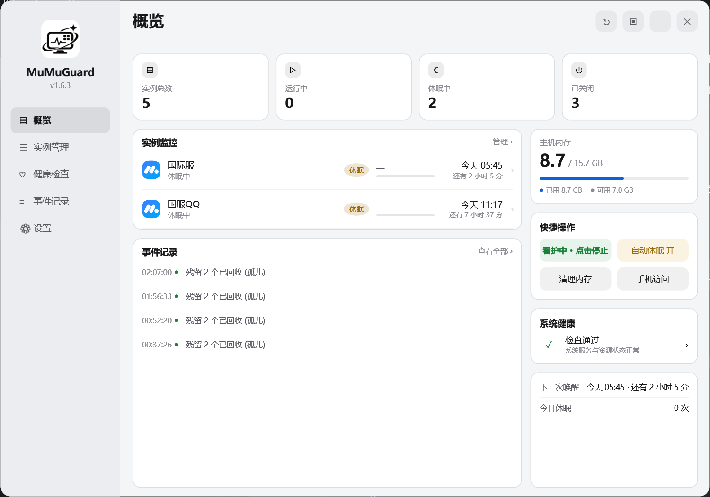

# MuMuGuard：MuMu 模拟器多开看护面板

盯着每个实例，掉线自动拉起，等升级时休眠省内存，醒来自动接着跑。


<br clear="left">

---

## 它是什么

MuMuGuard 是给 MuMu 模拟器多开用的看护面板，运行在 Windows 10 / 11 上。它把每个实例的状态收在一个窗口里：内存、CPU、脚本和游戏是否在跑、升级还剩多久。脚本掉了会自动重启，等建筑升级时可以关掉模拟器省内存，快到时间再打开。

它不改 MuMu 本体，不改你的多开配置，不装系统服务，也不上传数据。看护要手动点开始，程序不会自己启动，窗口也不会强制置顶。

项目地址：[github.com/suuk324/MuMuGuard](https://github.com/suuk324/MuMuGuard)

---

## 2.1.1 更新了什么

- **修复了一些问题**。
- **实例内存统计更准确**：新 MuMu 引擎把虚拟机内存放在 MuMuVMMHeadless.exe，之前只统计前端进程，6G 实例会显示成 0.1GB；现在合并统计，概览 / 实例管理 / 实例详情 / 手机端一致；实例详情页的内存占用行也恢复显示。
## 2.0.24 更新了什么

- **修复「手机上休眠/关机实例看不到资源量」**：手机端（局域网页和出门在外共用）状态里，休眠和已关机实例是单独补进列表的，补的时候漏了资源字段，所以只显示「尚未采集」。现在会带上磁盘上最近一次的采集结果（主世界金/圣/黑、夜世界兵金/兵圣），并标「上次」和采集时间。
## 2.0.23 更新了什么

- **修复「有休眠任务但到点不唤醒」**：公告弹窗是模态的，之前在公告之后才启动唤醒器和看护计时器；用户没点掉公告时唤醒器根本没起来。现在先启动唤醒器和看护计时器，再弹公告。
- **唤醒器进程检测收紧**：只认 `-File ...Waker.ps1` 形式的真实唤醒器，不会被命令行里带 `Waker.ps1` 的无关进程误判成「已在运行」。
## 2.0.22 更新了什么

- **修复「游戏在前台也被休眠」**：前台判定函数和后台采样模块里的同名函数互相覆盖，导致休眠判定拿不到「游戏在前台」的结果。已拆成两个不同名字的函数并加回归测试，前台一定不睡；取不到前台包名时也不累计后台空闲（宁可晚睡不误睡）。
- **修复「刚关机休眠记录就被撤销」**：新增 90 秒关机宽限期、采集数据必须新鲜（60 秒内）、连续 3 次确认才撤销，撤销后计数清零。避免实例刚 shutdown、adb 还报旧状态时把记录误撤，导致不按时唤醒。
- **唤醒器单实例 + 不再覆盖休眠记录**：唤醒器加了互斥量（强杀后也能正常接替）；只在任务有变化时才写 `sleep.json`，并把写入改成原子替换，面板新加的记录不会再被旧快照覆盖丢失。
- **修复「休眠/关机后实例详情里资源和截图都没了」**：详情页之前只在实例运行时才读取资源和截图，一休眠就整段跳过；现在关机/休眠时照样读取磁盘上最近一次采集的数据和截图，并标注「上次」和采集时间。
- **修复「资源数据和截图过一会儿没了」**：后台采样线程把新截图写到了 `%LOCALAPPDATA%\MuMuGuard\shots`，而界面/手机读的是面板目录下的 `shots`，两边对不上；现在统一写回面板目录，旧目录里已有的图会自动迁移回来（不会丢数据）。
- **重启后面板先用磁盘数据补上**：实例详情/卡片会读取最近一次采集结果并标「上次」，不用等下一次采样成功才显示。
- **手机卡片里能看游戏截图了**：局域网直接读 `/api/shot`；出门在外点开卡片时向电脑请求一张缩略图（JPEG，宽 360，两张约 50KB），显示在资源和开关之间。
- **截图只按需发送**：不会塞进每次状态，只在点开卡片时发一次，日常流量不增加。
- **出门在外也能点实例看卡片**：手机上点任意实例从底部弹出卡片，能看主世界/夜世界资源、开关「升级上号」、重启实例。
- **公告窗口固定在面板上面**：之前公告可能被主窗口挡住，点不到、系统还会叮叮响；现在公告、设置、详情等弹窗打开时都会自动来到最前面。
- **修复「出门在外」二维码不显示**：配对地址变长后超出原二维码容量，生成失败只留一个白框；现在二维码支持到更大容量，长地址也能正常扫。
- **修复强退后打不开**：上个实例被任务管理器强杀后，再双击会误判成「已在运行」直接退出；现在会正常启动。
- **手机端改成「先列表、点实例弹卡片」**：默认只显示实例列表，点哪个实例就从底部弹出卡片，卡片里能看主世界/夜世界资源、游戏截图、开关「升级上号」、重启实例。
- **界面更跟手**：资源识别挪到后台线程，不再隔几秒卡一下；窗口最小化后不做无谓刷新；单次刷新约 0.1~0.2 秒。
- **修了三个老问题**：设置页很多项点了没反应、概览和实例管理的休眠时间对不上、局域网刷新令牌后端口乱跳。
- **去掉强制置顶**：启动、从托盘打开、手机访问窗口都不再临时压到最前。
- **远程页更可靠**：数据超过 15 秒没更新会提示「已停止更新，请重新扫码」并禁用按钮；指令会显示执行结果，12 秒没回执提示设备无响应。

---

## 界面

2.0.0 把界面重做成左侧导航加右侧内容区，一共五个页面。主题有跟随系统、深色、浅色三种，在设置页点一下即时切换，不用重启。


| 页面 | 放什么 |
|---|---|
| **概览** | 实例总数、运行中、休眠中、已关闭四张统计卡；实例监控；最近事件；主机内存；快捷操作；系统健康；下一次唤醒和今日休眠 |
| **实例管理** | 每个实例一行，带检测开关、详情，以及启动 / 唤醒 / 重启 |
| **健康检查** | 内存压缩、系统预取、Mem Reduct、页面文件、CEF、权限六项体检 |
| **事件记录** | 今日休眠、自动唤醒、内存清理、异常恢复四个数字，下面是完整事件，可搜索和筛选 |
| **设置** | 24 项可调项，分休眠、掉线恢复、资源告警与清理、路径与包名、其它五组 |




---

## 能做什么

| 功能 | 说明 |
|---|---|
| **多开监控** | 自动发现 MuMu 实例，显示内存、CPU、CEF 进程数、脚本与游戏状态 |
| **掉线自恢复** | 连续检测到脚本或游戏掉线后重启实例，并重新拉起脚本 |
| **空转识别** | 脚本在跑但 CPU 长期很低时标出来，避免白挂一晚上 |
| **CEF 泄漏清理** | 清掉堆积的浏览器组件进程（`CefViewWing.exe`），每个实例保留指定数量 |
| **升级休眠** | 等升级时关掉模拟器省内存，升级完成前自动唤醒 |
| **资源识别** | 从游戏画面读出主世界/夜世界的金币、圣水、黑油，显示在实例卡片和手机上 |
| **健康自检** | 内存压缩、系统预取、Mem Reduct、页面文件、CEF 权限六项 |
| **事件搜索** | 按实例名或事件内容找记录，也能只看告警或只看休眠 |
| **手机看状态** | 局域网扫码：实例列表 + 点开卡片（资源、截图、升级上号开关、重启）；走公网中转：点实例看卡片（资源、游戏截图、升级上号开关、重启）+ 四个常用动作 |
| **托盘与紧凑视图** | 收起后只留托盘图标，紧凑视图 344×182 挂在角落 |

**它不做什么**：不上传你的数据、不安装常驻服务、不改 MuMu 本体、不动你的多开配置、不抢窗口置顶。

---

## 手机上看

两种方式，在面板右侧「快捷操作 → 手机访问」里切换。

**同一 WiFi（局域网）**：打开服务后出现二维码和网址（形如 `http://192.168.x.x:8790/?k=一串口令`），手机扫码即可。手机页每 2 秒刷新一次，可以看实例列表、点实例看资源和截图、开关升级上号、重启实例、看护/休眠/清理等。

**出门在外（公共中转）**：走 `broker.emqx.io` 中转，不需要同一 WiFi，页面能看实例状态、点实例看资源和升级上号开关、重启实例，另有看护/休眠/清理/唤醒四个常用动作。页面地址带配对信息，数据用 HMAC 签名，指令也要签名才执行。数据停更超过 15 秒会提示重新扫码；重新配对后旧链接会失效。

> 手机页每次发布都会带版本号，浏览器不会拿旧缓存。端口被占用时程序会自动顺延，以弹窗里显示的地址为准。

---

## 怎么安装

### 方式一：下载 exe

1. 到 [Releases](../../releases) 下载最新的 `MuMuGuard.exe`（可对照同名 `.sha256` 校验）
2. 放到一个固定文件夹，**不要放 `C:\Program Files`**，那里写配置会有权限问题
3. 双击运行。SmartScreen 提示未知发布者时，点「更多信息」再点「仍要运行」

首次启动会在程序所在目录创建 `config.json`，并自动查找 MuMu 安装位置。

### 方式二：源码运行

```powershell
git clone https://github.com/suuk324/MuMuGuard.git
cd MuMuGuard
powershell -STA -NoProfile -ExecutionPolicy Bypass -File .\MuMuGuardApp.ps1
```

需要 PowerShell 5.1，Windows 10 / 11 自带，不用另外装。

### 数据放在哪

程序按这个顺序找配置：exe 所在目录的 `_dist\config.json` → exe 所在目录的 `config.json` → `%LOCALAPPDATA%\MuMuGuard\config.json`。所以把 exe 放进仓库的 `_dist`，源码版和 exe 版读写的是同一份设置、休眠任务和日志。把 exe 复制到别处时，它会用新位置的数据，看起来像设置丢了，把旧的 `config.json` 复制过去即可。

---

## 第一次使用

1. 先启动 MuMu 和你的脚本
2. 打开 MuMuGuard，点侧栏 **实例管理**，确认实例都被认出来
3. 回 **概览**，点「开始看护」；需要省内存的话再点一下「自动休眠 关」变成开启
4. 平时用紧凑视图挂着，要看细节点回来

看护是手动开启的。开机自启默认也是关的，即使打开也只是进托盘，不会自动开始看护。

---

## 设置项说明

设置页一共 24 项，按五组排列。改完立刻保存，不需要重启。

### 休眠

| 设置项 | 默认 | 说明 |
|---|---|---|
| 自动休眠 | 关 | 脚本在等升级时关掉模拟器省内存，升级前自动唤醒 |
| 后台也休眠 | 开 | 游戏退到后台时也允许休眠 |
| 后台空闲判定 | 10 分钟 | 游戏退到后台多少分钟后，才按「在等升级」处理 |
| 提前唤醒 | 10 分钟 | 升级完成前多少分钟启动模拟器 |
| 最短休眠 | 1 小时 | 剩余时间比这短就不睡，避免反复开关机 |
| 最长休眠 | 168 小时 | 剩余时间比这长就不睡，比如两天以上 |

### 掉线恢复

| 设置项 | 默认 | 说明 |
|---|---|---|
| 掉线自动恢复 | 开 | 脚本或游戏掉线时重启实例，并重新拉起脚本 |
| 检测间隔 | 60 秒 | 每隔多久检查一次实例是否掉线 |
| 连续几次判定掉线 | 2 次 | 连续失败这么多次才重启，减少误判 |
| 恢复冷却 | 10 分钟 | 两次自动恢复之间至少隔这么久，防止反复重启 |

### 资源告警与清理

| 设置项 | 默认 | 说明 |
|---|---|---|
| 清理间隔 | 5 分钟 | 看护每隔多久做一次内存清理，0 表示不清理 |
| 低内存告警 | 800 MB | 主机可用内存低于这个值时报警 |
| 单实例内存告警 | 9216 MB | 单个实例占用超过这个值时报警 |
| CPU 告警 | 4 核 | 单个实例 CPU 占用超过这个值时标记出来 |
| CEF 泄漏阈值 | 20 个 | 单个实例的 CEF 进程超过这个数判定泄漏 |
| CEF 保留数量 | 2 个 | 清理时每个实例保留几个 CEF 进程 |
| 仅清理闲置进程 | 5 分钟 | 只清理闲置超过这么多分钟的 CEF 进程 |
| 空转阈值 | 5% | CPU 低于这个百分比视为空转，可被清理 |

### 路径与包名

| 设置项 | 说明 |
|---|---|
| MuMu 安装路径 | `MuMuManager.exe` 所在目录，换版本后改这里；留空会自动查找 |
| 脚本包名 | 判断脚本是否在运行，默认 `com.coc.zkqcode` |
| 游戏包名 | 判断游戏是否在前台，默认国服+国际服两个包名 |

### 其它

| 设置项 | 默认 | 说明 |
|---|---|---|
| 开机自动启动 | 关 | 开机后自动进托盘常驻（写注册表启动项） |
| 日志保留 | 7 天 | 超过这个天数的日志自动删除 |
| 主题 | 跟随系统 | 点一下在跟随系统 / 深色 / 浅色之间切换 |
| 清除记忆 | — | 删除休眠任务、趋势、统计与日志（设置保留） |

---

## 常见问题

**为什么读不到升级时间？**

需要游戏在跑，脚本是常用 CoC 脚本（默认包名 `com.coc.zkqcode`）。换了脚本就在设置里改「脚本包名」。游戏完全没启动时读不到升级任务。多账号时按「最早完成的那个」算，避免睡过头。

**休眠后唤醒失败？**

多半是权限不一致：MuMu 以管理员身份运行，面板不是，或者反过来。健康检查页的「权限」会标出「需管理员」，两边都用管理员运行即可。

**手机扫码打不开？**

先确认手机和电脑在同一个 Wi-Fi、弹窗里服务已开启、防火墙放行了面板。端口被占用时程序会自动顺延，以弹窗里显示的地址为准。旧二维码在刷新令牌或重新配对后会失效，用新码。

**手机页数据不动了？**

超过 15 秒没更新会显示「数据已停止更新，请重新扫码」，一般是电脑关了、程序没开，或者已经重新配对过。电脑上重新打开服务、扫新码即可。

**为什么窗口不再自动跳到最前面？**

2.0.16 去掉了强制置顶，启动和从托盘打开只激活窗口，不再压在其他程序上面。如果没看到窗口，点任务栏图标或托盘图标。

**清除记忆会删什么？**

删休眠任务、内存趋势、今日统计、事件记录、日志和已导出的报告；保留 `config.json`，所以设置不用重配。清除后当天数字立即归零。

**从旧版本升上来，设置会丢吗？**

不会。新版本会补上缺的默认项，旧配置自动备份成 `.bak`。个别默认值调整过的项，升级后建议到设置页再看一眼。

**任务栏图标是 PowerShell 的？**

用 exe 启动有独立图标；用脚本启动会显示 PowerShell 图标，这是正常的。

---

## 更新日志

- **2.0.23** 修复公告弹窗挡住启动流程导致「有休眠任务但不启动唤醒器」；唤醒器进程检测收紧，避免无关进程误判。
- **2.0.22** 修复游戏在前台也被休眠（前台判定函数重名失效）、刚关机休眠记录被误撤销；唤醒器改单实例、只在有变化时原子写 sleep.json，不再覆盖丢记录。
- **2.0.21** 修复休眠/关机后实例详情看不到资源和截图：详情页不再只在运行中才显示，关机/休眠时读磁盘最近一次采集并标「上次」和采集时间。
- **2.0.20** 修复资源数据和截图「自己消失」：后台采样线程写错目录导致界面/手机读不到新图，现已统一回面板目录并自动迁移旧数据；重启后先用磁盘最近数据补显示。
- **2.0.19** 出门在外卡片支持游戏截图（按需传缩略图，约 50KB/次）；局域网页截图保持原样。
- **2.0.18** 出门在外页支持点实例弹出卡片（资源/升级上号/重启）；公告和各类弹窗打开时自动置前，不再被主窗口挡住；补上远控页的指令回执提示元素。
- **2.0.17** 修复出门在外二维码不显示（长地址超出二维码容量）；修复上个实例被强杀后下次双击打不开（互斥量异常）；二维码编码支持更大容量，并用参考实现逐版本校验过。
- **2.0.16** 手机端列表→点实例弹卡片；资源识别移后台线程、界面不卡；设置页点击修复；休眠时间统一口径；局域网刷新令牌端口不再漂移；去掉强制置顶；远程页加过期提示和指令回执。
- **2.0.15** 新增游戏截图（手机卡片里可看）；实例管理休眠行显示真实升级任务和唤醒时间；检测按钮改成「暂停检测 / 恢复检测」。
- **2.0.14** 手机端卡片：显示主世界/夜世界资源，可开关升级上号、重启实例，带执行回执；窄屏自适应。
- **2.0.13** 资源识别移到后台线程，手机端状态刷新限流，界面事件/实例行按需重建，窗口隐藏时不刷新。
- **2.0.11** 修复 OCR 数字串行（两种语言 OCR 结果按行对齐，不再把金币读成别的数字）。
- **2.0.10** 修复主世界被误判成夜世界（改用右侧图标判定世界，条数交叉校验）。
- **2.0.0** 界面重做：五个页面、深/浅色主题、紧凑视图、手机页。

---

## 反馈

- 提 issue：[github.com/suuk324/MuMuGuard/issues](https://github.com/suuk324/MuMuGuard/issues)
- QQ 群：**1128379535**

反馈问题时，附上系统版本、复现步骤，以及设置页「导出诊断报告」导出的文件，会好查很多。

---

## 许可

MIT，见 [LICENSE](LICENSE)。