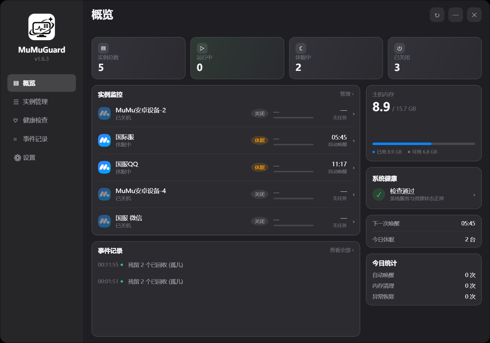
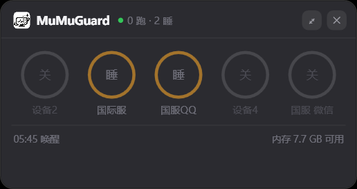
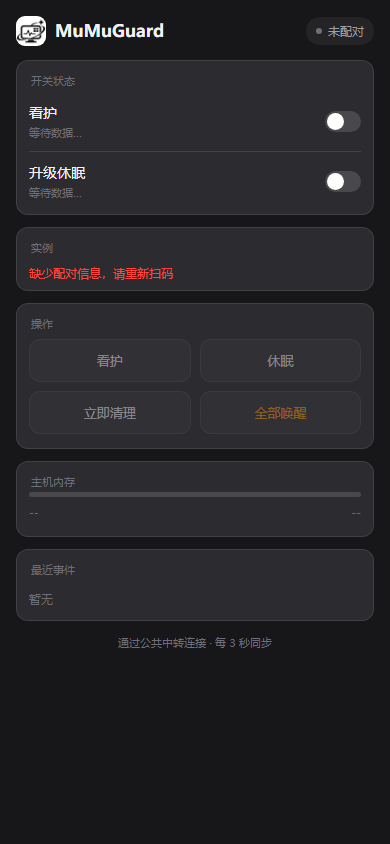
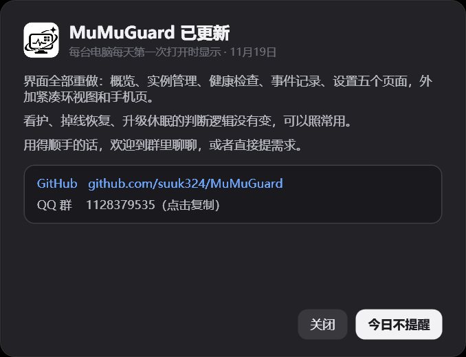

# MuMuGuard

**MuMu 模拟器多开看护面板。** 盯着你的每一个实例，掉线自动重启，等升级期间自动休眠省内存，醒来自己接着跑。


<br clear="left">

---

## 长什么样

**概览** — 打开就是全部实例的状态



**紧凑视图** — 挂角落里，只占 344×182



**手机上也能看**



---

## 它能做什么

| 功能 | 说明 |
|---|---|
| **多开监控** | 自动发现所有实例，显示内存、CEF 进程数、脚本与游戏状态 |
| **掉线自恢复** | 脚本或游戏掉了，自动重启实例并重新拉起脚本 |
| **空转识别** | 脚本在跑但一直空转，标记出来 |
| **CEF 泄漏清理** | 清掉堆积的 `CefViewWing.exe`，能还回几个 GB |
| **升级休眠** | 脚本只是在等建筑升级时关掉模拟器省内存，升级前自动唤醒 |
| **健康自检** | 内存压缩、SysMain、Mem Reduct、页面文件、CEF、权限，六项体检 |
| **手机看状态** | 局域网直连，或公网中转，在外面也能看一眼 |
| **托盘常驻** | 收起只留托盘图标，唤醒器独立运行 |

**它不做什么**：不上传你的数据、不常驻后台服务、不改 MuMu 本体、不动你的 6GB/6 核配置。

---

## 安装

### 方式一：下载 exe（推荐）

1. 到 [Releases](../../releases) 下载最新的 `MuMuGuard.exe`
2. 放到任意文件夹（**别放 `C:\Program Files`**，会有权限问题）
3. 双击运行

首次启动会在同目录生成 `config.json`，并自动找到 MuMu 安装位置。

### 方式二：源码运行

```powershell
git clone https://github.com/suuk324/MuMuGuard.git
cd MuMuGuard
powershell -STA -NoProfile -ExecutionPolicy Bypass -File .\MuMuGuardApp.ps1
```

需要 PowerShell 5.1（Windows 10/11 自带），不需要装任何东西。

---

## 第一次打开会看到公告

每天第一次打开时弹一次，写着最近的改动和联系方式。

- **关闭** — 关掉，下次打开还会出现
- **今日不提醒** — 今天不再弹，明天恢复

想再看一次：托盘图标右键 → **公告**。



---

## 使用

1. 先启动 MuMu 和你的脚本
2. 打开 MuMuGuard，点侧栏的 **实例管理**，确认实例都被认出来了
3. 点右上角开始看护
4. 平时挂 **紧凑视图** 就行，要看细节点回完整面板

> 看护是**手动开启**的。程序从不自动启动看护，也不写开机自启（除非你在设置里自己打开）。

---

## 界面说明

### 五个页面

| 页面 | 放什么 |
|---|---|
| **概览** | 统计、实例列表、最近事件、主机内存曲线、健康摘要、今日统计 |
| **实例管理** | 每个实例的检测开关，以及启动 / 唤醒 / 重启 |
| **健康检查** | 六项系统体检，异常会标出来 |
| **事件记录** | 完整日志，可按「告警 / 休眠」筛选 |
| **设置** | 休眠规则、守护参数、告警阈值、路径 |

### 紧凑视图

五个环一行排开：

- **蓝色进度环** = 运行中，中间是内存占用百分比
- **琥珀色圈 + 睡** = 休眠中，脚注显示几点唤醒
- **灰圈 + 关** = 已关机

### 手机页面

| 方式 | 用途 |
|---|---|
| 局域网 | 手机和电脑同一个 Wi-Fi，扫码直接连，数据不出内网 |
| 公网中转 | 不在家也能看，走 MQTT 中转，内容用 HMAC 签名，别人伪造不了 |

四个按钮对应真实动作：看护开关、休眠开关、立即清理、全部唤醒。

---

## 配置

`config.json` 里常用的一项一行，也可以在 **设置** 页改。

| 配置项 | 默认 | 说明 |
|---|---|---|
| `MemAlertMB` | 9216 | 实例内存告警阈值（读不到实例配置时的兜底） |
| `CefAlert` | 20 | CEF 进程数超过就触发清理 |
| `CefStaleMin` | 10 | 只清理存在超过 N 分钟的 CEF |
| `CpuAlert` | 4.0 | CPU 核数超过标记「CPU 偏高」 |
| `GuardMinute` | 5 | 看护清理间隔（分钟） |
| `AutoRecover` | true | 掉线自动恢复 |
| `RecoverCheckSec` | 60 | 掉线检测间隔（秒） |
| `RecoverFailCount` | 2 | 连续几次判定掉线 |
| `AutoSleep` | false | 升级休眠（默认关，需要自己开） |
| `SleepBackground` | true | 游戏切到后台时也允许休眠 |
| `SleepIdleMin` | 10 | 后台空闲多少分钟才判定在等升级 |
| `SleepLeadMin` | 10 | 升级完成前多少分钟唤醒 |
| `SleepMinHours` | 1 | 最短休眠时长，太短就不睡 |
| `SleepMaxHours` | 168 | 最长休眠时长 |
| `DetectOff` | [] | 不检测的实例号 |
| `LogKeepDays` | 7 | 日志保留天数 |
| `Theme` | auto | `auto` 跟随系统 / `dark` / `light` |
| `UpdateRepo` | suuk324/MuMuGuard | 检查更新用的仓库 |

---

## 常见问题

**为什么读不到升级时间？**
需要游戏在跑、脚本是 coc 的常用脚本（默认包名 `com.coc.zkqcode`）。配置里 `PkgScript` 改成你自己的包名。

**休眠后唤醒失败？**
检查 MuMu 是不是以管理员身份运行、而面板不是——权限不一致会导致控制失效。健康检查页的「权限」会标出来，两边都管理员运行即可。

**任务栏图标变成 PowerShell 的？**
用 exe 启动就有独立图标；用脚本启动会显示 PowerShell 图标，正常。

**数据存在哪？**
exe 同目录：`config.json`、`sleep.json`、`logs\`。不上传任何地方。

---

## 反馈

- 提 issue：[github.com/suuk324/MuMuGuard/issues](https://github.com/suuk324/MuMuGuard/issues)
- QQ 群：**1128379535**（用久了有想法、想加功能，直接群里说）

---

## 许可

MIT