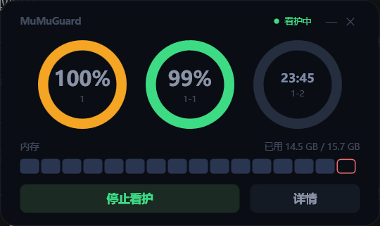
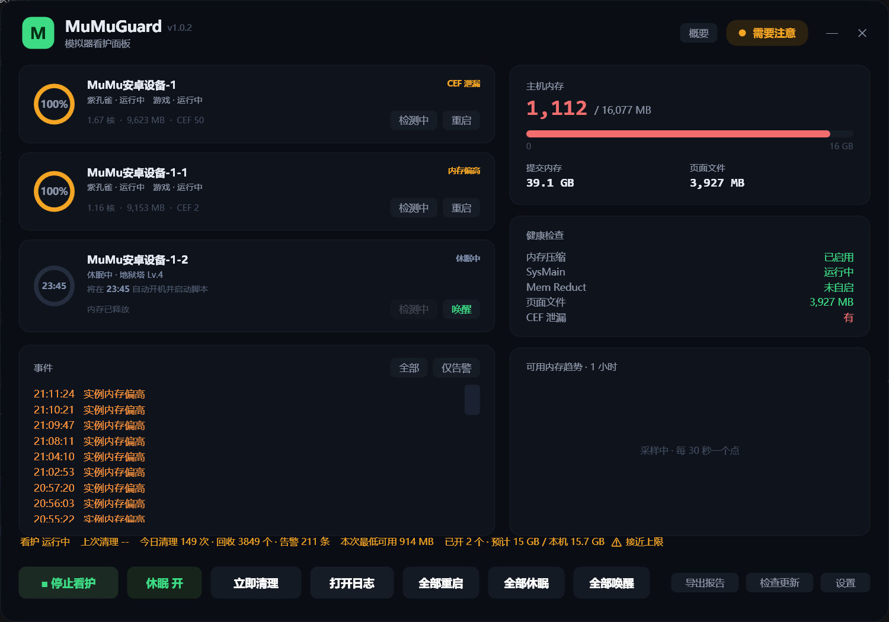



# MuMuGuard · MuMu 模拟器看护面板

给 MuMu 模拟器多开用的轻量监控与自动化工具。**打开就用，关掉即走**，不留后台服务。


---

## 界面

**紧凑视图**（平时挂在角落，只占一小块）



实例多于一屏时自动切成列表。环的填充是内存占用，环里的大字是百分比，休眠中的实例显示唤醒时间。

**详情视图**



---

## 它能做什么

| 功能 | 说明 |
|---|---|
| **多开监控** | 自动发现所有实例，显示内存占用、CPU、CEF 进程数 |
| **掉线自恢复** | 脚本或游戏掉线时自动重启实例并重新拉起脚本 |
| **空转识别** | 脚本在跑但一直空转时标记出来 |
| **CEF 泄漏清理** | 清理堆积的 `CefViewWing.exe`，释放被吃掉的几个 GB |
| **升级休眠** | 脚本只是在等建筑升级时，自动关掉模拟器省内存，升级前自动唤醒 |
| **健康自检** | 主机内存/提交内存/实例内存偏低时预警 |
| **一键操作** | 全部重启 / 全部休眠 / 全部唤醒 |
| **托盘常驻** | 收起后只在托盘留一个图标，唤醒器独立运行 |

**它不做什么**：不联网（除了检查更新）、不上传数据、不常驻服务、不修改 MuMu 本体。

---

## 安装

### 方式一：下载 exe（推荐）

1. 到 [Releases](../../releases) 下载最新 `MuMuGuard.exe`
2. 放到任意文件夹（建议不要放 `C:\Program Files`，避免权限问题）
3. 双击运行

首次启动会在同目录生成 `config.json`，并自动检测 MuMu 安装位置。

### 方式二：源码运行

```powershell
git clone https://github.com/suuk324/MuMuGuard.git
cd MuMuGuard
# 双击 启动面板.vbs，或：
powershell -STA -NoProfile -ExecutionPolicy Bypass -File .\MuMuGuardApp.ps1
```

需要 PowerShell 5.1（Windows 10/11 自带）。

---

## 使用

1. 先启动 MuMu 和要玩的脚本
2. 打开 MuMuGuard，点 **启动看护**
3. 点 **详情** 看每个实例的状态
4. 不用了点 **停止看护**，或直接关窗口（会收进托盘）

> 看护是**手动开启**的。程序从不自动启动看护，也不写开机自启（除非你在设置里自己勾）。

---

## 界面说明

### 紧凑视图

实例少时显示环形图：

- **环的填充** = 该实例内存 / 它的内存上限
- **环里的大字** = 内存百分比；休眠中的实例显示唤醒时间
- **虚线圈** = 已暂停检测或休眠中

实例超过 5 个自动切成列表模式，每行显示名称、内存条、状态。

### 详情视图

每个实例一张卡片：

- 紫孔雀 / 游戏 的运行状态
- 剩余升级时间（如果能读到）
- 判断结果：正常 / 脚本停止 / 空转 / CEF 泄漏 / 内存偏高
- 单个实例的重启、检测开关

底部是事件流、健康检查、内存趋势、全局开关和批量操作。

---

## 配置

首次运行自动生成 `config.json`，也可以点界面右下角 **设置** 修改。

| 配置项 | 默认值 | 说明 |
|---|---|---|
| `MemAlertMB` | 9216 | 实例内存告警阈值（读不到实例配置时的兜底） |
| `CefAlert` | 20 | CEF 进程数超过这个值触发清理 |
| `CefStaleMin` | 10 | 只清理存在超过 N 分钟的 CEF |
| `CpuAlert` | 4.0 | CPU 核数超过这个值标记为「CPU 偏高」 |
| `GuardMinute` | 5 | 看护清理间隔（分钟） |
| `AutoRecover` | true | 掉线自动恢复 |
| `AutoSleep` | false | 升级休眠（默认关闭，需要自己在设置里开） |
| `SleepLeadMin` | 10 | 升级完成前多少分钟唤醒 |
| `PkgScript` | `com.coc.zkqcode` | 你的脚本包名 |
| `UpdateRepo` | `suuk324/MuMuGuard` | 检查更新用的仓库 |
| `Theme` | `auto` | 界面主题：`auto` 跟随系统 / `dark` 深色 / `light` 浅色 |

各实例的内存刻度会优先读 MuMu 自己的配置（`vms\...\vm_config.json` 的 `vm.memory`），所以 4G 和 6G 的实例刻度各自正确。

---

## 需要 root 吗

**不需要，但有了更好。**

| 功能 | 无 root | 有 root |
|---|---|---|
| 内存 / CPU / 进程监控 | ✅ | ✅ |
| 掉线恢复 | ✅ | ✅ |
| CEF 清理 | ✅ | ✅ |
| 升级剩余时间 | ❌ | ✅ |
| 升级休眠 | ❌ | ✅ |

升级时间是从游戏脚本写的 `memory.json` 里读的，需要读 `/storage/emulated/0/` 下的文件，所以要 root（KernelSU / Magisk 都行）。

---

## 杀软误报

程序会**结束进程**、**关闭模拟器**、**写注册表**（仅在你开启开机自启时）。这些行为可能被安全软件拦截，属于正常现象。

如果被杀软隔离：

1. 把程序所在文件夹加入白名单
2. 或改用源码运行（更容易判断安全性）

**为什么会有误报**：exe 是用 PS2EXE 把 PowerShell 脚本封装成可执行文件，这个封装方式被一些恶意软件用过，所以会被启发式扫描盯上。

---

## 自动更新

程序启动后会静默检查 GitHub Releases（24 小时一次），也可以从托盘菜单手动检查。

发现新版本 → 下载 → 校验 SHA256 → 关闭程序 → 替换 → 重启。替换失败会自动回滚到 `.bak`。

> 如果你在国内访问 GitHub 慢，可以在 `config.json` 里设 `UpdateMirror`，填一个加速前缀（如 `https://ghproxy.net/`）。

---

## 已知限制

- **只支持 MuMu**（12 / 15 已测试），其它模拟器不识别
- **Windows 10/11 only**，Win7 不支持
- **实例名**读自 MuMu 的 `extra_config.json`，在 MuMu 多开器里改名后会跟着变
- **CEF 泄漏本身是 MuMu 的问题**，本工具只能定期清理，治不了根
- 10 个以上实例时，adb 采集会错峰轮询，数据有几秒到几十秒延迟

---

## 开发

```powershell
# 检查编码（PS 5.1 需要 UTF-8 BOM）与语法
.\Check-BOM.ps1
.\Check-BOM.ps1 -Fix

# 单元测试
.\tests\Run-Tests.ps1

# 打包（生成 exe + 源码包 + SHA256）
.\build\release.ps1 -Version 1.0.1
```

### 文件结构

```
MuMuGuardApp.ps1     入口：配置、界面、事件绑定、定时器
lib\90-pure.ps1      纯函数（可单测）
lib\00-common.ps1    日志、配置、辅助脚本定位
lib\05-instances.ps1 实例发现与配置读取
lib\10-data.ps1      数据采集
lib\20-actions.ps1   清理、恢复、休眠、批量操作
lib\30-ui.ps1        界面渲染
lib\40-tray.ps1      托盘与退出
lib\50-update.ps1    检查更新
Waker.ps1            独立唤醒进程
Restart-Instance.ps1 重启实例并拉起脚本
Update-Helper.ps1    更新替换助手
build\               打包脚本
tests\               单元测试
```

> **注意**：所有 `.ps1` 必须带 UTF-8 BOM。PowerShell 5.1 会把无 BOM 的文件按 GBK 解析，中文全乱、程序起不来。改完代码跑一次 `Check-BOM.ps1`。

---

## 许可

[MIT](LICENSE)

## 致谢

给紫孔雀脚本用户做的，但不限于此。欢迎提 issue 和 PR。
