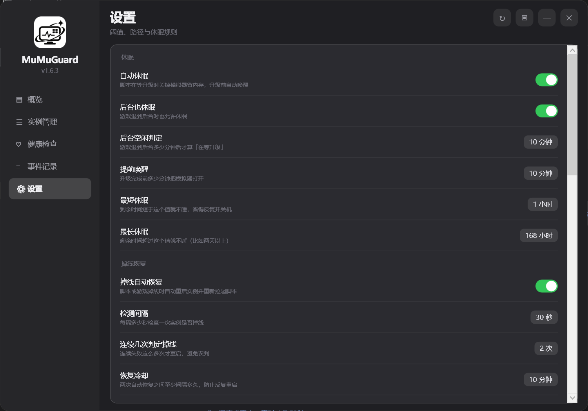

# MuMuGuard：MuMu 模拟器《部落冲突》多开看护面板

面向 MuMu 模拟器多开挂《部落冲突》的 Windows 看护工具，基于紫孔雀脚本开发：盯着每个实例，脚本或游戏掉了自动拉起，等升级时休眠省内存，醒来自动接着跑。


<br clear="left">

---

## 它是什么

MuMuGuard 是运行在 Windows 10 / 11 上的 MuMu 模拟器多开看护面板，面向《部落冲突》（COC）挂机场景开发。它把每个实例的状态收在一个窗口里：内存、CPU、紫孔雀脚本和游戏是否在跑、升级还剩多久。脚本或游戏掉了会自动重启，等建筑升级时可以关掉模拟器省内存，快到时间再打开。

当前只适配 **紫孔雀脚本**（包名 `com.coc.zkqcode`）。脚本在线判断、升级时间读取、自动休眠/唤醒、掉线恢复、资源 OCR 都是按「COC + 紫孔雀」这一套实现的；其他 COC 脚本、其他游戏没有做适配，不能保证这些功能正常。

它不改 MuMu 本体，不改你的多开配置，不装系统服务，也不上传数据。看护要手动点开始，程序不会自己启动，窗口也不会强制置顶。

项目地址：[github.com/suuk324/MuMuGuard](https://github.com/suuk324/MuMuGuard)

---

## 适用范围（先看）

| 项目 | 支持情况 |
|---|---|
| MuMu 模拟器（Windows 10 / 11） | **支持**，仅面向 Windows 版 MuMu |
| 《部落冲突》国服 / 国际服 | **支持**，默认游戏包名覆盖两个版本 |
| 紫孔雀脚本（`com.coc.zkqcode`） | **当前唯一适配的脚本** |
| 其他《部落冲突》脚本 | 未适配，不保证脚本在线判断、升级时间、休眠/恢复正常 |
| 其他游戏 | 基础实例监控可以看，但休眠、掉线恢复、资源识别等不保证 |
| 雷电 / 夜神 / 其他模拟器 | **不支持** |

> 简单说：**MuMu + 部落冲突 + 紫孔雀脚本** 是这套软件的目标场景；超出这个范围，请先按「不保证可用」看待。

---

## 界面

界面是左侧导航加右侧内容区，一共六个页面。主题有跟随系统、深色、浅色三种，在设置页点一下即时切换，不用重启。


| 页面 | 放什么 |
|---|---|
| **概览** | 实例总数、运行中、休眠中、已关闭四张统计卡；实例监控；最近事件；主机内存；快捷操作；系统健康；下一次唤醒和今日休眠 |
| **实例管理** | 每个实例一行，带检测开关、详情，以及启动 / 唤醒 / 重启 |
| **健康检查** | 内存压缩、系统预取、Mem Reduct、页面文件、CEF、权限六项体检 |
| **事件记录** | 今日休眠、自动唤醒、内存清理、异常恢复四个数字，下面是完整事件，可搜索和筛选 |
| **设置** | 24 项可调项，分休眠、掉线恢复、资源告警与清理、路径与包名、其它五组 |
| **配置同步** | 选一个运行中的实例当模板，把紫孔雀 `zkq_config.json` 同步到其他运行中的实例；同步前可备份，同步后可重启紫孔雀，带 MD5 校验 |




---

## 能做什么

以下功能默认围绕「COC + 紫孔雀脚本」工作；基础监控对其他游戏实例可能可用，但看护相关功能不保证。

| 功能 | 说明 |
|---|---|
| **多开监控** | 自动发现 MuMu 实例，显示内存、CPU、CEF 进程数、紫孔雀脚本与游戏状态 |
| **掉线自恢复** | 连续检测到紫孔雀脚本或 COC 游戏掉线后重启实例，并重新拉起紫孔雀 |
| **空转识别** | 紫孔雀脚本在跑但 CPU 长期很低时标出来，避免白挂一晚上 |
| **CEF 泄漏清理** | 清掉堆积的浏览器组件进程（`CefViewWing.exe`），每个实例保留指定数量 |
| **升级休眠** | 紫孔雀读到升级完成后关掉模拟器省内存，升级完成前自动唤醒 |
| **资源识别** | 从 COC 游戏画面读出主世界/夜世界的金币、圣水、黑油，显示在实例卡片和手机上 |
| **健康自检** | 内存压缩、系统预取、Mem Reduct、页面文件、CEF 权限六项 |
| **事件搜索** | 按实例名或事件内容找记录，也能只看告警或只看休眠 |
| **手机看状态** | 局域网扫码：实例列表 + 点开卡片（资源、截图、升级上号开关、重启）；走公网中转：点实例看卡片（资源、游戏截图、升级上号开关、重启）+ 四个常用动作 |
| **配置同步** | 独立页面：把源实例的紫孔雀配置同步到目标实例，支持备份、MD5 校验、同步后重启紫孔雀；只处理运行中的实例 |
| **托盘与紧凑视图** | 收起后只留托盘图标，紧凑视图 344×182 挂在角落 |

**它不做什么**：不面向其他模拟器或其他游戏做适配；不上传你的数据、不安装常驻服务、不改 MuMu 本体、不动你的多开配置、不抢窗口置顶。

---

## 手机上看

两种方式，在面板右侧「快捷操作 → 手机访问」里切换。

**同一 WiFi（局域网）**：打开服务后出现二维码和网址（形如 `http://192.168.x.x:8790/?k=一串口令`），手机扫码即可。手机页每 2 秒刷新一次，可以看实例列表、点实例看资源和截图、开关升级上号、重启实例、看护/休眠/清理等。

**出门在外（公共中转）**：走 `broker.emqx.io` 中转，不需要同一 WiFi，页面能看实例状态、点实例看资源和升级上号开关、重启实例，另有看护/休眠/清理/唤醒四个常用动作。页面地址带配对信息，数据用 HMAC 签名，指令也要签名才执行。数据停更超过 15 秒会提示重新扫码；重新配对后旧链接会失效。

> 手机页每次发布都会带版本号，浏览器不会拿旧缓存。端口被占用时程序会自动顺延，以弹窗里显示的地址为准。

---

## 配置同步

侧栏 **配置同步** 是独立模块，用来把某个实例的紫孔雀配置复制到其他实例。

- 选一个**正在运行**的实例作为源（模板）
- 勾选要同步的目标实例；关机和休眠实例会显示「未启动，跳过」
- 可选「同步前备份原配置」，备份放在 `_dist\backup\zkq-sync\`
- 可选「同步后重启紫孔雀」；关闭时同步后会强制停止紫孔雀，新配置下次启动才生效
- 同步前会先强制停止目标实例的紫孔雀，避免运行中的旧配置写回；推送后比对设备端和本地 MD5，不一致会自动重推一次
- 同步日志和状态单独保存在 `_dist\logs\zkq-sync.log`、`_dist\zkq-sync-status.json`，不写 `config.json`，也不影响看护、休眠和手机端

同步期间会临时跳过目标实例的自动掉线恢复，并暂停自动休眠，避免刚拉起的紫孔雀被误判为掉线或被立刻休眠。

---

## 怎么安装

### 方式一：下载 exe

1. 到 [Releases](../../releases) 下载最新的 `MuMuGuard.exe`（可对照同名 `.sha256` 校验）
2. 放到一个固定文件夹，**不要放 `C:\Program Files`**，那里写配置会有权限问题
3. 双击运行。SmartScreen 提示未知发布者时，点「更多信息」再点「仍要运行」

首次启动会在程序所在目录创建 `config.json`，并自动查找 MuMu 安装位置。

### 方式二：源码运行

```powershell
git clone https://github.com/suuk324/MuMuGuard.git
cd MuMuGuard
powershell -STA -NoProfile -ExecutionPolicy Bypass -File .\MuMuGuardApp.ps1
```

需要 PowerShell 5.1，Windows 10 / 11 自带，不用另外装。

### 数据放在哪

程序按这个顺序找配置：exe 所在目录的 `_dist\config.json` → exe 所在目录的 `config.json` → `%LOCALAPPDATA%\MuMuGuard\config.json`。所以把 exe 放进仓库的 `_dist`，源码版和 exe 版读写的是同一份设置、休眠任务和日志。把 exe 复制到别处时，它会用新位置的数据，看起来像设置丢了，把旧的 `config.json` 复制过去即可。

---

## 第一次使用

1. 先启动 MuMu 和紫孔雀脚本，并让脚本开始挂 COC
2. 打开 MuMuGuard，点侧栏 **实例管理**，确认实例都被认出来
3. 回 **概览**，点「开始看护」；需要省内存的话再点一下「自动休眠 关」变成开启
4. 平时用紧凑视图挂着，要看细节点回来

看护是手动开启的。开机自启默认也是关的，即使打开也只是进托盘，不会自动开始看护。

---

## 设置项说明

设置页一共 24 项，按五组排列。改完立刻保存，不需要重启。

### 休眠

| 设置项 | 默认 | 说明 |
|---|---|---|
| 自动休眠 | 关 | 紫孔雀脚本在等升级时关掉模拟器省内存，升级前自动唤醒 |
| 后台也休眠 | 开 | 游戏退到后台时也允许休眠 |
| 后台空闲判定 | 10 分钟 | 游戏退到后台多少分钟后，才按「在等升级」处理 |
| 提前唤醒 | 10 分钟 | 升级完成前多少分钟启动模拟器 |
| 最短休眠 | 1 小时 | 剩余时间比这短就不睡，避免反复开关机 |
| 最长休眠 | 168 小时 | 剩余时间比这长就不睡，比如两天以上 |

### 掉线恢复

| 设置项 | 默认 | 说明 |
|---|---|---|
| 掉线自动恢复 | 开 | 紫孔雀脚本或 COC 游戏掉线时重启实例，并重新拉起紫孔雀 |
| 检测间隔 | 60 秒 | 每隔多久检查一次实例是否掉线 |
| 连续几次判定掉线 | 2 次 | 连续失败这么多次才重启，减少误判 |
| 恢复冷却 | 10 分钟 | 两次自动恢复之间至少隔这么久，防止反复重启 |

### 资源告警与清理

| 设置项 | 默认 | 说明 |
|---|---|---|
| 清理间隔 | 5 分钟 | 看护每隔多久做一次内存清理，0 表示不清理 |
| 低内存告警 | 800 MB | 主机可用内存低于这个值时报警 |
| 单实例内存告警 | 9216 MB | 单个实例占用超过这个值时报警 |
| CPU 告警 | 4 核 | 单个实例 CPU 占用超过这个值时标记出来 |
| CEF 泄漏阈值 | 20 个 | 单个实例的 CEF 进程超过这个数判定泄漏 |
| CEF 保留数量 | 2 个 | 清理时每个实例保留几个 CEF 进程 |
| 仅清理闲置进程 | 5 分钟 | 只清理闲置超过这么多分钟的 CEF 进程 |
| 空转阈值 | 5% | CPU 低于这个百分比视为空转，可被清理 |

### 路径与包名

| 设置项 | 说明 |
|---|---|
| MuMu 安装路径 | `MuMuManager.exe` 所在目录，换版本后改这里；留空会自动查找 |
| 脚本包名 | 判断紫孔雀脚本是否在运行，默认 `com.coc.zkqcode`；当前只适配紫孔雀，改成别的包名不代表支持其他脚本 |
| 游戏包名 | 判断游戏是否在前台，默认国服+国际服两个包名 |

### 其它

| 设置项 | 默认 | 说明 |
|---|---|---|
| 开机自动启动 | 关 | 开机后自动进托盘常驻（写注册表启动项） |
| 日志保留 | 7 天 | 超过这个天数的日志自动删除 |
| 主题 | 跟随系统 | 点一下在跟随系统 / 深色 / 浅色之间切换 |
| 清除记忆 | — | 删除休眠任务、趋势、统计与日志（设置保留） |

---

## 常见问题

**为什么读不到升级时间？**

需要 COC 游戏在跑，并且脚本是当前唯一适配的**紫孔雀脚本**（默认包名 `com.coc.zkqcode`）。升级时间来自紫孔雀写入的 `memory.json`；其他 COC 脚本或其他游戏没有这套数据，所以读不到，自动休眠/唤醒也会失效。游戏完全没启动时同样读不到。多账号时按「最早完成的那个」算，避免睡过头。

**休眠后唤醒失败？**

多半是权限不一致：MuMu 以管理员身份运行，面板不是，或者反过来。健康检查页的「权限」会标出「需管理员」，两边都用管理员运行即可。

**手机扫码打不开？**

先确认手机和电脑在同一个 Wi-Fi、弹窗里服务已开启、防火墙放行了面板。端口被占用时程序会自动顺延，以弹窗里显示的地址为准。旧二维码在刷新令牌或重新配对后会失效，用新码。

**手机页数据不动了？**

超过 15 秒没更新会显示「数据已停止更新，请重新扫码」，一般是电脑关了、程序没开，或者已经重新配对过。电脑上重新打开服务、扫新码即可。

**为什么窗口不再自动跳到最前面？**

2.0.16 去掉了强制置顶，启动和从托盘打开只激活窗口，不再压在其他程序上面。如果没看到窗口，点任务栏图标或托盘图标。

**清除记忆会删什么？**

删休眠任务、内存趋势、今日统计、事件记录、日志和已导出的报告；保留 `config.json`，所以设置不用重配。清除后当天数字立即归零。

**从旧版本升上来，设置会丢吗？**

不会。新版本会补上缺的默认项，旧配置自动备份成 `.bak`。个别默认值调整过的项，升级后建议到设置页再看一眼。

**任务栏图标是 PowerShell 的？**

用 exe 启动有独立图标；用脚本启动会显示 PowerShell 图标，这是正常的。

---

## 更新记录

各版本更新说明见 [CHANGELOG.md](CHANGELOG.md)。

---

## 反馈

- 提 issue：[github.com/suuk324/MuMuGuard/issues](https://github.com/suuk324/MuMuGuard/issues)
- QQ 群：**1128379535**

反馈问题时，附上系统版本、复现步骤，以及设置页「导出诊断报告」导出的文件，会好查很多。

---

## 许可

MIT，见 [LICENSE](LICENSE)。